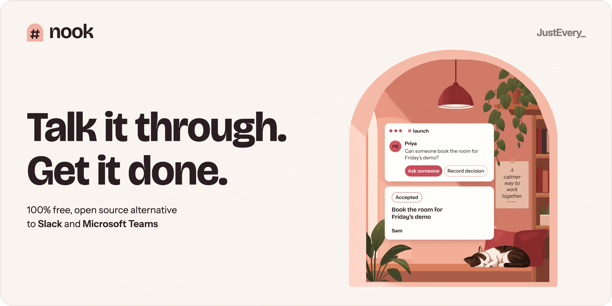
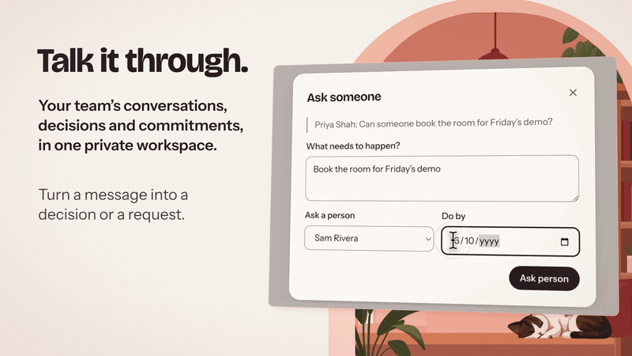
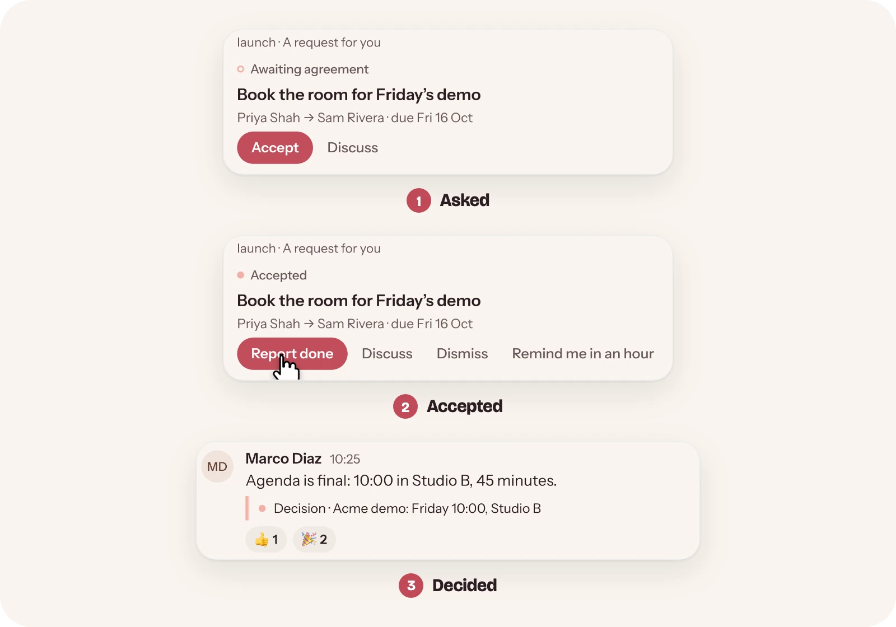
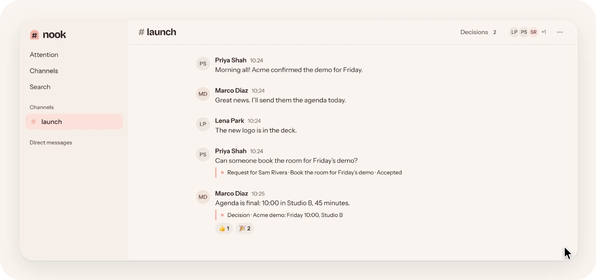
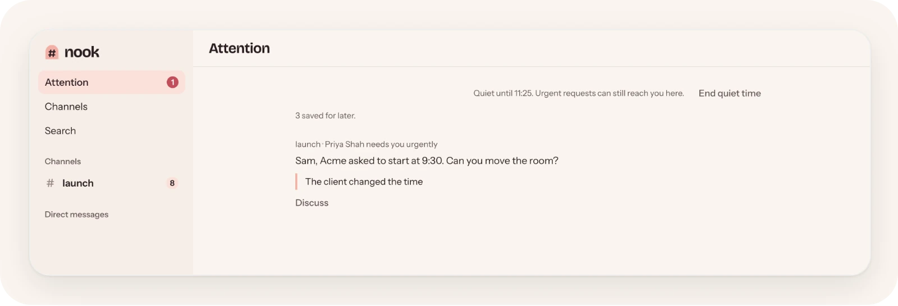

<p align="center">
  <a href="https://run-nook.com">
    <picture>
      <source media="(prefers-color-scheme: dark)" srcset=".github/assets/banner-dark.webp">
      <source media="(prefers-color-scheme: light)" srcset=".github/assets/banner-light.webp">
      
    </picture>
  </a>
</p>

<p align="center"><a href="https://run-nook.com">run-nook.com</a> · <a href="https://justevery.com">Part of Just Every</a> · <a href="LICENSE">MIT licensed</a></p>

<p align="center">
  <a href="https://justevery.com/#vol-nook"></a>
</p>
<p align="center"><a href="https://justevery.com/#vol-nook"><b>Watch the full demo</b></a> · 49 seconds</p>

<p align="center">
  
</p>

<p align="center">
  <br>
  <sub>Requests and decisions live in the thread, where everyone can see them.</sub>
</p>

<p align="center">
  <br>
  <sub>Quiet time saves the rest for later; an urgent request still reaches you.</sub>
</p>

# Nook

Nook is a team workspace with private channels, fixed-participant DMs, threads,
versioned decisions, commitments that only their assignee can accept, private
files and calm attention. It runs as one Cloudflare Worker: React/TanStack Start
documents, a Hono HTTP boundary, D1 storage and Base operator-auth sign-in.

## Run it on your computer

Use Node **22.20.0** and pnpm **10.12.4** (`.node-version` and `packageManager`
pin them). Install the `rer` command once: `npx -y @runeditrun/rer cli install`
(it runs this checkout's own pinned commands). Get the source with
`git clone https://github.com/just-every/run-nook.git` and `cd run-nook`; every
command below runs from that checkout.

The commands use an example local identity. Replace `you@example.com` and
`Your name` with your own email address and name, and use the same email address
in the outbox command below.

```sh
pnpm install --frozen-lockfile          # or: rer install
rer setup --owner-email you@example.com --owner-name 'Your name'
rer dev
```

`setup` writes owner-only private settings to `.dev.vars`, builds the Worker,
applies every local D1 migration, claims you as the first owner, puts a sign-in
message in the development outbox and stops the app again. It prints
`RER_SETUP_READY` and the next step. Pass `--port P` to choose the local port;
later commands reuse it.

`dev` starts the app with live reload and prints `RER_READY http://127.0.0.1:P`,
`RER_SIGNED_IN you@example.com` and an `RER_OPEN` link. Open that link on this
computer and Nook opens signed in as you through a local-only dev session. The
link carries this checkout's dev key in its fragment, so treat it like a
password and keep it on this computer. Your first visit lands on `/setup`:
confirm the owner account there once and Nook opens the workspace. Until you do,
every app page sends you back to `/setup`.

A dev-only badge switches between you, signed out and one person for each other
role: `admin@dev.localhost`, `member@dev.localhost` and `guest@dev.localhost` (a
guest sees only the first channel). `dev --as member` starts as that person;
`dev --as signed-out` starts signed out. To sign in the way a real person does,
run `dev --login`: it prints `RER_SIGN_IN` and an `RER_OPEN` link to the local
outbox. Choose the newest sign-in message, follow its link and press
**Confirm**. No email is sent and no provider account is needed.

```sh
rer outbox             # print the outbox link of the running app
rer outbox --owner-email you@example.com   # request a fresh link
rer dev --stop
rer verify             # the complete test suite
```

Only people the owner invites can join; a sign-in request for an unknown
mailbox creates nothing. Prefer a
browser wizard? `node scripts/install.mjs` opens the same setup as a guided
installer.

`rer preview` serves the production build with the same owner
and data, and `rer doctor` reports tool versions, missing
inputs and where your local state lives. `rer describe` lists
every command and flag. Each verb is also a package script, for example
`pnpm run dev -- --port 8790`.

### Move or reset your data

Stop the app first. Export writes one private archive; import restores it into
an empty installation.

```sh
rer export --output exports/nook.rer
rer reset --yes
rer import --input exports/nook.rer --yes
```

The archive holds every conversation, message, decision, commitment, file and
attention choice with integrity checks. It leaves out sessions, sign-in links,
outbox mail, push subscriptions/keys/presence, pending deliveries and generated settings. After import, recover the archived people
before setup with the offline mapping in [OPERATIONS.md](OPERATIONS.md).
`reset` lists what it will remove and refuses without `--yes`; it keeps source,
dependencies, `exports/` and deploy receipts.

### Deploy to your own Cloudflare account

```sh
rer deploy --dry-run
CLOUDFLARE_ACCOUNT_ID=… CLOUDFLARE_API_TOKEN=… OWNER_EMAIL=… MAIL_FROM=… SENDGRID_API_KEY=… \
  rer deploy
```

The dry run builds and validates the Worker, assets and every migration with no
provider request. A real deploy uses Base deploy-kit's owner-account mode: it
creates or reuses the D1 database and Worker named after this project, applies
pending migrations, uploads the build and checks health. It generates the
production session secret and setup token once and keeps them in
`.rer/deploy/production-secrets.json`. Claim the production owner with that
setup token, and update to newer source later, with the commands in
[Updating and deploying](docs/updating.md). `rer release --repo . --output DIR --dry-run`
runs the Base release checks, including the publication scan.

## Where things live

Local data is in `.wrangler/state`, private settings in `.dev.vars`, CLI
bookkeeping in `.rer/local` and installer drafts in `.seed/installer`. Setup and
build refuse ambiguous or aliased state instead of guessing; see
[OPERATIONS.md](OPERATIONS.md) for recovery.

Product records live in normalized D1 tables and every file's bytes in private
R2. A Durable Object pushes small "something changed" hints to open tabs; the
client then catches up through the authoritative replay API, which rechecks
membership on every read. Upgrading an installation that still holds the old
single workspace document is an explicit, resumable offline conversion in
[OPERATIONS.md](OPERATIONS.md).

Product rules live in `src/family/team-chat`, sign-in and D1 access in
`src/platform`, and routing in `src/server.ts`. The rer CLI, installer and command tooling come from the pinned
`@runeditrun/rer` package. Runtime copies of operator-auth, mail and portability
are recorded in `base-copies.json` and checked by
`node scripts/edition-authoring/cli.mjs verify-base`. Imported history from
other tools keeps its provenance without creating unread, attention or accepted
work; see [IMPORT-APPLY.md](IMPORT-APPLY.md). Managed RER installations add a signed owner claim, the
owner-scoped editor authority API and a pinned trusted-build workflow; see
[OPERATIONS.md](OPERATIONS.md). [CONTRACT.md](CONTRACT.md) states
the product guarantees and [ACCEPTANCE.md](ACCEPTANCE.md) what has been proven.

User guides live in `docs/` and are published at `/docs`.
Add a guide in `docs/site.json` with its Markdown source and navigation label; give every unpublished root Markdown file a reason under `githubOnly`.

## Local storage measurement

`node scripts/storage/measure.mjs --state=PRIVATE_SCALE_STATE --evidence=DIR --messages=1000000 --seconds=900`
runs the built Worker locally with 50 synthetic people signed in through the
ordinary auth routes and 50 live connections, bulk-loads a disclosed test-only
corpus of one million messages, then measures sends from 20 concurrent senders,
search, history, replay, edits, deletions and fanout. If seeding pauses (exit 2),
run the same command again to resume. The report is a measurement, not a
capacity promise.

Web Push and installation controls are in **You**. Push starts off, uses a separate channel from email, and sends visible encrypted alerts through the browser vendor. See [Attention](docs/attention.md), [Privacy](docs/privacy.md), and the operator guide below. Real-device receipt and sleeping-device background clearing remain separate evidence limits.
